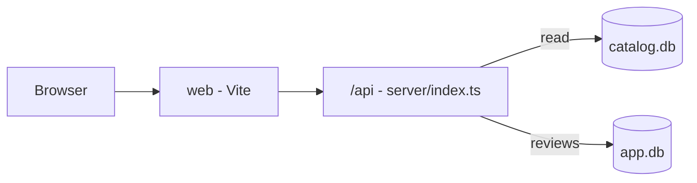

# Netflix Explorer

Netflix Explorer is a small web app to browse the public Netflix catalog (movies and shows), see how many hours each title was watched and how long it stayed in the weekly top 10, and read or send short reviews that a moderator approves.

## Start

```bash
npm install
npm run setup
npm start
```

Then open http://localhost:3000. Requires Node 24.



## What lives where

| Path | What it holds |
| --- | --- |
| `server/` | HTTP server, API routes, SQL queries and static file serving |
| `server/domain/` | Business rules, such as how hours viewed are computed |
| `web/` | Browser UI: HTML, TypeScript and CSS (built by Vite into `dist/`) |
| `scripts/` | `setup.ts`, which downloads the catalog and creates the app database |
| `tests/` | Vitest tests (`tests/server`, `tests/web`) |
| `specs/` | Feature specs |
| `curso/` | Tools of the course (`romper`, `paso`), not part of the app |
| `data/` | SQLite databases created by setup (not in git) |

## npm scripts

- `npm run setup`: download the catalog, create `data/app.db` and `.env`.
- `npm run build`: build the web app into `dist/`.
- `npm start`: build, then start the server on `PORT` (default 3000).
- `npm run typecheck`: type-check the whole project.
- `npm test`: run the unit tests.
- `npm run test:web`: run the tests in `tests/web`.

## Specs

`specs/` has three specs. Specs 1 (catalog) and 2 (reviews) are implemented; spec 3 (top 10 history) is not started.
